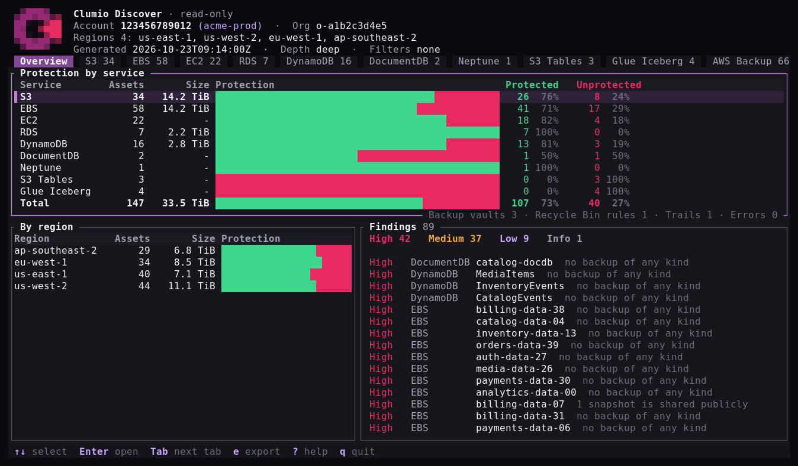
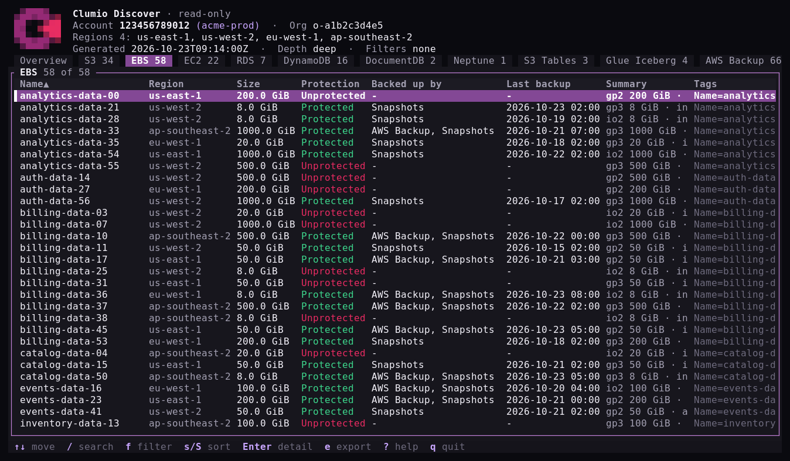

# Clumio Discover

See everything in your AWS account that Clumio can protect, and how well it's
protected today.

> Provided as-is by the Commvault Cloud Natives Resilience team. Not a supported
> Commvault product. Clumio and Commvault are trademarks of Commvault Systems,
> Inc.



- **Read-only.** Only Describe, List and Get calls. Nothing in your account is
  created, changed or deleted.
- **Nothing to install in AWS.** No CloudFormation, roles or agents. It runs on
  your machine with your existing AWS login.
- **Stays with you.** Results are shown on screen or saved to a local file.
  Nothing is sent anywhere.

## What you need

1. The `clumio-discover` program for your platform. See [Install](#install).
2. An AWS login for the account to scan, the same one you use with the AWS CLI,
   or [AWS CloudShell](#aws-cloudshell), which needs no login setup at all.
3. Read access. The AWS managed policy **ReadOnlyAccess** (or admin) is enough.
   For least privilege, use the
   [`clumio-discover-readonly.json`](policy/clumio-discover-readonly.json)
   policy included in the download instead.

## Install

Pick the build for your computer:

| Computer | `TARGET` |
|---|---|
| Mac with Apple silicon (M1 or later) | `aarch64-apple-darwin` |
| Mac with Intel | `x86_64-apple-darwin` |
| Linux x86_64, including AWS CloudShell | `x86_64-unknown-linux-musl` |
| Linux arm64 (Graviton) | `aarch64-unknown-linux-musl` |
| Windows | `x86_64-pc-windows-msvc` |

The Linux builds run on any distribution, including Amazon Linux 2 and 2023.

### macOS and Linux

Download with the [GitHub CLI](https://cli.github.com), signed in with
`gh auth login`:

```
TARGET=aarch64-apple-darwin
gh release download --repo cvlt-cloudnatives-resilience/clumio-discover-releases \
  --pattern "*-$TARGET.tar.gz" --pattern SHA256SUMS
```

or with curl:

```
TARGET=aarch64-apple-darwin
VERSION=v0.3.0
BASE=https://github.com/cvlt-cloudnatives-resilience/clumio-discover-releases/releases/download/$VERSION
curl -fLO "$BASE/clumio-discover-$VERSION-$TARGET.tar.gz"
curl -fLO "$BASE/SHA256SUMS"
```

Check the download, unpack it and run it:

```
shasum -a 256 --ignore-missing -c SHA256SUMS     # on Linux: sha256sum --ignore-missing -c SHA256SUMS
tar -xzf clumio-discover-*-$TARGET.tar.gz
cd clumio-discover-*-$TARGET
./clumio-discover
```

To run it from any folder, move it onto your PATH:

```
sudo mkdir -p /usr/local/bin && sudo mv clumio-discover /usr/local/bin/
```

Downloads made with `gh` or curl open without a warning. If you downloaded with
a browser and macOS says the program can't be opened because it's from an
unidentified developer, clear the download flag once:

```
xattr -d com.apple.quarantine clumio-discover
```

### Windows

In PowerShell, download with the GitHub CLI:

```
gh release download --repo cvlt-cloudnatives-resilience/clumio-discover-releases --pattern "*-x86_64-pc-windows-msvc.zip"
```

or with `Invoke-WebRequest`:

```
$Version = "v0.3.0"
$Name = "clumio-discover-$Version-x86_64-pc-windows-msvc"
Invoke-WebRequest "https://github.com/cvlt-cloudnatives-resilience/clumio-discover-releases/releases/download/$Version/$Name.zip" -OutFile "$Name.zip"
```

Then unpack and run it:

```
Expand-Archive clumio-discover-*-x86_64-pc-windows-msvc.zip -DestinationPath .
cd clumio-discover-*-x86_64-pc-windows-msvc
.\clumio-discover.exe
```

If SmartScreen warns about an unrecognised app, choose **More info**, then
**Run anyway**, or run `Unblock-File clumio-discover.exe` first.

### AWS CloudShell

CloudShell runs in your browser from the AWS console and is already signed in
as you, so there is nothing to install on your computer and no credentials to
set up.

1. Sign in to the AWS console for the account to scan and open **CloudShell**
   from the toolbar.
2. Get the Linux build into CloudShell, either with curl:

   ```
   TARGET=$(uname -m)-unknown-linux-musl
   VERSION=v0.3.0
   curl -fLO "https://github.com/cvlt-cloudnatives-resilience/clumio-discover-releases/releases/download/$VERSION/clumio-discover-$VERSION-$TARGET.tar.gz"
   ```

   or by downloading the `x86_64-unknown-linux-musl` build on your computer and
   choosing **Actions → Upload file** in CloudShell.
3. Unpack and run it:

   ```
   tar -xzf clumio-discover-*-linux-musl.tar.gz
   cd clumio-discover-*-linux-musl
   ./clumio-discover
   ```

4. To take the results with you, print the saved file's full path with
   `realpath inventory-*.json`, then choose **Actions → Download file** and
   paste it in.

Files in your CloudShell home folder are kept between sessions, so you can scan
again later without downloading it again.

## Run it

```
clumio-discover
```

Use `./clumio-discover` if you're in the unpacked folder and haven't moved it
onto your PATH. It scans every AWS region Clumio supports, saves the results to
`inventory-<account>-<date>.json` in the current folder, then opens the
inventory browser. To use a different AWS profile:

```
clumio-discover --profile my-profile
```

## Find your way around

| Key | Action |
|---|---|
| `Tab` / `←` `→` | Switch section: Overview, S3, EBS, EC2, RDS, DynamoDB, Findings… |
| `↑` `↓` | Move through a list |
| `Enter` / `Esc` | Open / close the details of a resource |
| `/` | Search |
| `f` | Filter, for example only unprotected resources |
| `e` | Export the current list to CSV and JSON |
| `q` | Quit |

Each resource is **Protected** (it has at least one backup) or **Unprotected**
(it has none). **Backed up by** shows where its backups come from, and **Last
backup** shows the newest one. See
[How protection is decided](#how-protection-is-decided).



**Findings** lists risks worth fixing, most serious first, such as unencrypted
volumes, tables without point-in-time recovery, or publicly shared snapshots.

## How protection is decided

A resource is **Protected** if it has at least one of these backups, and
**Unprotected** if it has none:

| Resource | Backed up by |
|---|---|
| Any resource | **AWS Backup**: a recovery point in an AWS Backup vault, in any region |
| EBS volume | **Snapshots** of the volume |
| EC2 instance | **AMIs** of the instance, or **Snapshots** of its volumes |
| RDS, Aurora, DocumentDB, Neptune | **Automated backups** switched on, or manual **Snapshots** |
| DynamoDB table | **PITR** (point-in-time recovery) switched on, or **On-demand backups** |
| S3 bucket | **AWS Backup** only; see below |

Good to know:

- **S3 versioning, replication and object lock are not backups.** A delete or
  corruption is versioned or replicated along with everything else, in the same
  account. They're shown in the bucket's details, but a bucket with only these
  is Unprotected.
- **AWS Backup stores some backups as snapshots.** Its EBS, EC2 and some
  DynamoDB backups are ordinary snapshots, AMIs or on-demand backups, so they
  are listed under those too, for example "AWS Backup, Snapshots". Volumes of
  an EC2 instance that AWS Backup protects show only "Snapshots", because AWS
  Backup records the instance rather than each volume.

## Deep scan

```
clumio-discover --deep
```

Also checks every EBS snapshot, RDS snapshot and AMI for public or
cross-account sharing. Recommended; on accounts with tens of thousands of
snapshots it takes a few minutes longer.

## Share the results

Every scan saves its results to `inventory-<account>-<date>.json`. Send that
file back to whoever asked you to run the scan, or open it again later on any
machine. Opening it needs no AWS access:

```
clumio-discover view inventory-123456789012-20261023T091400.json
```

The file contains resource names, IDs and tags from your account. Treat it as
confidential. To skip saving, add `--no-save`; to save without opening the
browser, use `--out <file>`.

## Options

Optional settings go in `~/.config/clumio-discover/config.toml`. Copy
[`config.example.toml`](config.example.toml) to get started; it covers
choosing regions, turning services off, and scanning only resources with a
given tag.

## Check that nothing changed

Every call the tool makes is recorded in AWS CloudTrail. In the CloudTrail
console, open **Event history**, filter by the user that ran the scan, and
confirm every event is read-only.

## Missing permissions

If your login can't read something, the scan still finishes. What it couldn't
read is listed in the **Errors** section, so you can add the permission and
scan again.

## License

[Apache License 2.0](LICENSE). Copyright 2026 Tirslo.
